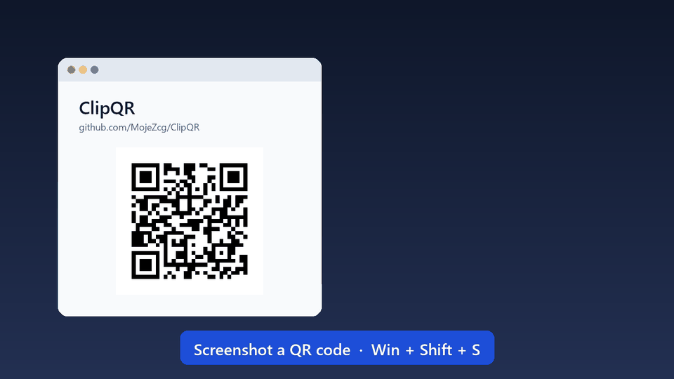

<p align="center"><a href="README.md">Español</a> · <b>English</b></p>

<p align="center">
  <picture>
    <source media="(prefers-color-scheme: dark)" srcset="assets/logo-white.png">
    
  </picture>
</p>

<h1 align="center">ClipQR</h1>

<p align="center">
  <b>Screenshot a QR code and use it right away.</b><br>
  Detects QR codes and barcodes in whatever you copy or capture on Windows, and lets you copy each field,
  join the Wi‑Fi network, save the contact or open the link, in one click.
</p>

<p align="center">
  
  
  
  
  
  <a href="https://cafecito.app/mojezcg"></a>
</p>



## How it works

1. Take a screenshot (`Win`+`Shift`+`S` or `Print Screen`), copy an image, or copy an image file in File Explorer. Or press **`Win`+`Shift`+`Q`** and drag around the QR code with the mouse: it's read instantly, with no screenshot and no clipboard involved.
2. If it contains a QR code or a barcode, a notification appears in the top-right corner of the monitor you're on.
3. Choose what to do: copy one field, copy everything, copy just a part, or use the action button. Press **`Ctrl`+`Shift`+`Space`** to drive it from the keyboard: `Enter` runs the action, `1`–`9` copies that field, `Esc` closes it.

**Nothing runs on its own.** ClipQR never opens links or joins networks by itself: there's always a button, and you're the one who presses it. For links, it warns you when something looks off: an unencrypted connection, a shortened link, a domain that imitates another one or isn't what it seems.

## What it recognizes

| Type | Fields shown | Buttons |
|---|---|---|
| 📶 **Wi‑Fi** | Network, password (hidden), security | **Connect to network** |
| 👤 **Contact** (vCard / MeCard) | Name, company, phone, email, website… | **Save contact**, **Call**, **Write email**, **Open website** |
| 📅 **Event** | Title, start, end, location | **Add to calendar** |
| 🔗 **Link** | Domain | **Open link** |
| ✉️ **Email** | Recipient, subject, message | **Write email** |
| 📞 **Phone / SMS** | Number, message | **Call**, **Send SMS** |
| 📍 **Location** | Coordinates | **View on map** |
| 🔑 **2FA (otpauth)** | Account, issuer, secret (hidden) | — |
| 🧾 **Invoice** | Large amount, type, number, date, issuer, recipient, authorization code | **Verify** with the tax authority, **Copy summary** |
| 💳 **QR payment** | Amount, merchant, CVU/CBU, Pix key or IBAN, reference, network | **Copy payment code** (never pays by itself) |
| 🛒 **Product** (EAN / UPC / GS1) | GTIN, batch, serial, expiry date, weight | **Search product**, **View on GS1** |
| 🪪 **Argentine ID card (DNI)** | Holder, number, date of birth, copy | **Copy DNI** (not saved to history) |
| ✈️ **Boarding pass** | Flight, route, date, seat, booking | **Copy booking** (not saved to history) |
| 💬 **WhatsApp, Telegram, social networks, apps** | Number or username, message, app | **Open chat**, **Open in…** |
| 📄 **Text** | Any URLs and emails it contains | **Search on Google** |

**Invoices with QR codes:** Argentina (ARCA, formerly AFIP), Mexico (CFDI), Chile (SII), Peru (SUNAT), Colombia (DIAN), Uruguay (DGI), Brazil (NF-e / NFC-e), Ecuador (SRI), Spain (VeriFactu and TicketBAI) and Portugal (ATCUD). **Payments:** Transferencias 3.0 (Mercado Pago, MODO, banks), Pix and other EMVCo QR codes, SEPA transfers, Swiss QR-bill, UPI and cryptocurrencies (copy only). If something doesn't add up (tampered QR, invalid tax ID, expired product), it lets you know.

**Create QR** (`Win`+`Shift`+`G`): Wi‑Fi, contact, link, email, phone, SMS, WhatsApp or location, with custom colors and a logo. Copy it or save it as PNG or SVG.

It also reads DataMatrix, Aztec, PDF417, Code 128, Code 39 and other formats, thanks to [zxing-cpp](https://github.com/zxing-cpp/zxing-cpp). It works with screenshots, with blurry photos of printed QR codes, and with images that contain several codes at once.

## Screenshots

| Wi‑Fi | Contact |
|---|---|
|  |  |
| **Several codes in one image** | **Light theme** |
|  |  |
| **Searchable history** | **Settings** |
|  |  |

## Installation

### Windows

1. Download **`ClipQR-Setup.exe`** from [Releases](../../releases) and open it.
2. Choose whether it should start with Windows (and whether you want a desktop shortcut), then click **Install**.

That's it: it installs for your user in `%LOCALAPPDATA%\Programs\ClipQR`, with no administrator rights, and adds a Start menu shortcut. ClipQR sits in the system tray, next to the clock. To uninstall it: **Windows Settings › Apps › ClipQR**.

ClipQR's interface is available in English, Spanish, Portuguese, French, German, Italian, Simplified Chinese, Japanese, Russian and Korean. It follows the Windows language (English if yours isn't one of these) and can be changed in **Settings › Idioma · Language**.

Rather not install anything? Download **`ClipQR.exe`** (portable version) and run it directly.

> If Windows SmartScreen shows up ("Windows protected your PC"), click **More info → Run anyway**. It appears because the `.exe` files aren't digitally signed.

### macOS (11 or later, Apple Silicon)

1. Download **`ClipQR-macOS.zip`** from [Releases](../../releases), unzip it and move **ClipQR** to *Applications*.
2. The first time, right-click › **Open** (or *System Settings › Privacy & Security › Open Anyway*). The app isn't signed by Apple yet.
3. ClipQR lives in the menu bar. For keyboard shortcuts, allow it under *Privacy & Security › Accessibility*, and to scan an area, under *Screen Recording*.

Default shortcuts: ⌃⌥⌘Q scan an area, ⌃⌥⌘G create a QR code, ⌃⌥⌘Space use the notification with the keyboard.

### Linux (x86_64)

```bash
tar xzf ClipQR-Linux-x86_64.tar.gz && cd ClipQR-Linux-x86_64 && ./install.sh
```

It installs for your user in `~/.local/share/ClipQR`, with a launcher in the applications menu. Reading the clipboard needs **xclip** (X11) or **wl-clipboard** (Wayland). On Wayland there are no global shortcuts or area scanning, and on GNOME without a tray extension ClipQR opens as a window. To uninstall: `./uninstall.sh`.

**This is the first macOS and Linux release:** the Linux version has been tested; the macOS one only with automated tests. If something breaks, [open an issue](https://github.com/MojeZcg/ClipQR/issues/new/choose).

## Settings

From the ⚙ icon on the notification or from **Settings…** in the tray menu:

- **Notification:** how long it stays visible (5 s to 5 min), whether it closes by itself, pause on mouse hover, animation and position. You can also drag the notification around and pin it with 📌.
- **Appearance:** light theme, dark theme or the same as Windows.
- **Language:** English or Spanish; defaults to the Windows language.
- **Detection:** QR codes only or barcodes too, read files copied in File Explorer, play a sound on detection, and pause detection.
- **Delete the screenshot when a code is detected** (first in Settings, on by default): Windows saves every screenshot in *Pictures › Screenshots*. When one contains a QR code or barcode, ClipQR sends it to the Recycle Bin (so it can be restored), and every notification says so, with a **Turn off** button. Only the file identical to the screenshot is deleted. If you turn it off, the notification offers **Delete screenshot**.
- **History:** how many scans are kept, and clear the history.
- **Keyboard shortcuts:** scan an area of the screen (`Win`+`Shift`+`Q`), create a QR code (`Win`+`Shift`+`G`) and use the notification from the keyboard (`Ctrl`+`Shift`+`Space`). They can be changed or turned off. They are never `Ctrl`+`Alt`+letter, because on Spanish and Latin American keyboards that's `AltGr`, and it would stop you from typing @, #, €…
- **General:** start with Windows, check for updates (once a day; they're only installed if you accept, and after the installer has been verified) and an error report to paste into an issue.

Settings are stored in `%APPDATA%\ClipQR\settings.json`.

## Privacy

Everything is processed on your computer. ClipQR doesn't send images or data to any server. On its own, it only checks once a day whether there's a new version on GitHub (this can be turned off). Otherwise, it only uses the network when you press a button that needs it, such as opening a link or searching for a product. The history is kept in memory only and is cleared when the app closes. Full details in the [privacy policy](PRIVACY.en.md).

## Contributing

Want to add a language, your country's invoice format or fix something? Read the [contributing guide](CONTRIBUTING.md) and check the [good first issues](https://github.com/MojeZcg/ClipQR/labels/good%20first%20issue). Every bit helps, including reporting a QR code that isn't read correctly.

## Support the project

ClipQR is free and open source. If it saves you time, you can buy me a coffee on Cafecito ☕:

<a href="https://cafecito.app/mojezcg"></a>

It's also in the tray menu (**Buy me a coffee ☕**) and in **Settings › Support ClipQR**.

## License

[MIT](LICENSE)
