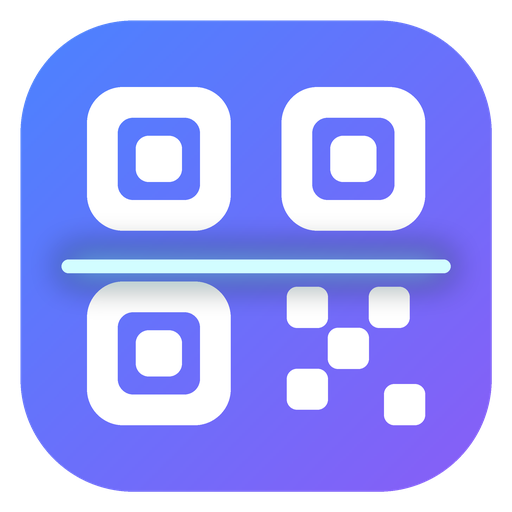
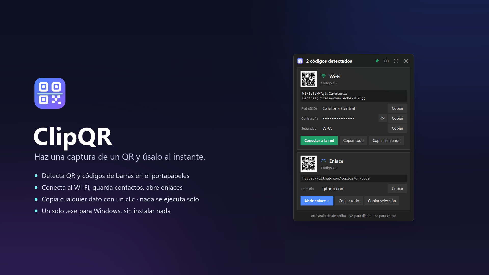
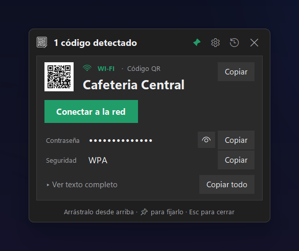
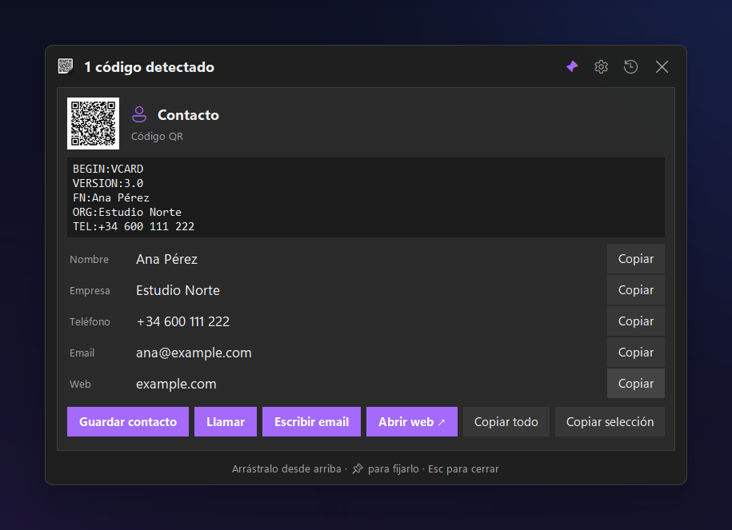
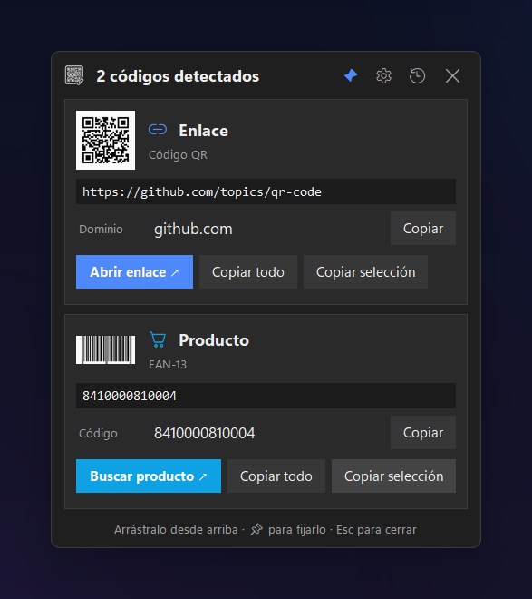
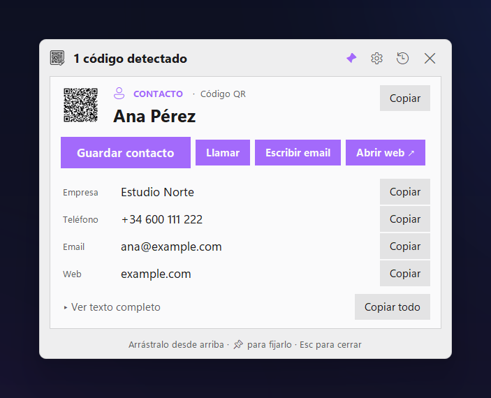
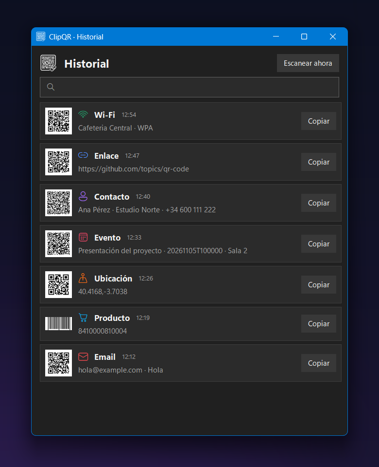
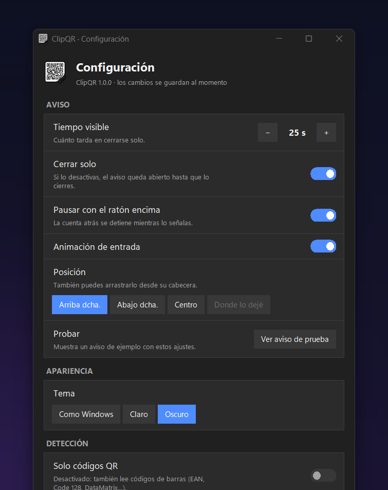

<p align="center">
  <picture>
    <source media="(prefers-color-scheme: dark)" srcset="assets/logo-white.png">
    
  </picture>
</p>

<h1 align="center">ClipQR</h1>

<p align="center">
  <b>Haz una captura de un QR y úsalo al instante.</b><br>
  Detecta QR y códigos de barras en lo que copias o capturas en Windows y te deja copiar cada dato,
  conectarte al Wi‑Fi, guardar el contacto o abrir el enlace, con un clic.
</p>

<p align="center">
  
  
  
</p>



## Cómo funciona

1. Haz una captura (`Win`+`Shift`+`S` o `Impr Pant`), copia una imagen o copia un archivo de imagen desde el Explorador.
2. Si contiene un QR o un código de barras, aparece un aviso arriba a la derecha.
3. Elige qué hacer: copiar un dato, copiar todo, copiar una parte o usar el botón de acción.

**Nada se ejecuta solo.** ClipQR nunca abre enlaces ni se conecta a redes por su cuenta: siempre hay un botón y lo pulsas tú.

## Qué reconoce

| Tipo | Datos que muestra | Botones |
|---|---|---|
| 📶 **Wi‑Fi** | Red, contraseña (oculta), seguridad | **Conectar a la red** |
| 👤 **Contacto** (vCard / MeCard) | Nombre, empresa, teléfono, email, web… | **Guardar contacto**, **Llamar**, **Escribir email**, **Abrir web** |
| 📅 **Evento** | Título, inicio, fin, lugar | **Añadir al calendario** |
| 🔗 **Enlace** | Dominio | **Abrir enlace** |
| ✉️ **Email** | Destinatario, asunto, mensaje | **Escribir email** |
| 📞 **Teléfono / SMS** | Número, mensaje | **Llamar**, **Enviar SMS** |
| 📍 **Ubicación** | Coordenadas | **Ver en el mapa** |
| 🔑 **2FA (otpauth)** | Cuenta, emisor, secreto (oculto) | — |
| 🛒 **Producto** (EAN / UPC) | Código | **Buscar producto** |
| 📄 **Texto** | URLs y emails que contenga | **Buscar en Google** |

También lee DataMatrix, Aztec, PDF417, Code 128, Code 39 y otros formatos, gracias a [zxing-cpp](https://github.com/zxing-cpp/zxing-cpp). Funciona con capturas de pantalla, con fotos borrosas de QR impresos y con imágenes que tienen varios códigos a la vez.

## Capturas

| Wi‑Fi | Contacto |
|---|---|
|  |  |
| **Varios códigos en una imagen** | **Tema claro** |
|  |  |
| **Historial con búsqueda** | **Configuración** |
|  |  |

## Instalación

1. Descarga **`ClipQR-Setup.exe`** desde [Releases](../../releases) y ábrelo.
2. Elige si quieres que se inicie con Windows (y si quieres un acceso directo en el escritorio) y pulsa **Instalar**.

Eso es todo: se instala para tu usuario en `%LOCALAPPDATA%\Programs\ClipQR`, sin permisos de administrador, con acceso directo en el menú Inicio. ClipQR queda en la bandeja del sistema, junto al reloj. Para desinstalarlo: **Configuración de Windows › Aplicaciones › ClipQR**.

¿Prefieres no instalar nada? Descarga **`ClipQR.exe`** (versión portátil) y ábrelo directamente.

> Si aparece Windows SmartScreen («Windows protegió su PC»), pulsa **Más información → Ejecutar de todas formas**. Aparece porque los `.exe` no están firmados digitalmente.

## Configuración

Desde el icono ⚙ del aviso o desde **Configuración…** en el menú de la bandeja:

- **Aviso:** tiempo visible (de 5 s a 5 min), cerrar solo o no, pausa con el ratón encima, animación y posición. El aviso también se puede arrastrar y fijar con 📌.
- **Apariencia:** tema claro, oscuro o el mismo que Windows.
- **Detección:** solo QR o también códigos de barras, leer archivos copiados desde el Explorador, sonido al detectar y pausar la detección.
- **Borrar las capturas con QR:** Windows guarda cada captura en *Imágenes › Capturas de pantalla*. Cuando una contiene un QR, el aviso ofrece **Borrar captura**, o lo hace solo si activas esta opción. Va a la Papelera (se puede recuperar) y solo se borra el archivo idéntico a la captura.
- **Historial:** cuántos escaneos se guardan y borrar el historial.
- **General:** iniciar con Windows.

Los ajustes se guardan en `%APPDATA%\ClipQR\settings.json`.

## Privacidad

Todo se procesa en tu equipo. ClipQR no envía imágenes ni datos a ningún servidor. Solo se usa la red cuando pulsas un botón que la necesita, como abrir un enlace o buscar un producto. El historial se guarda solo en memoria y se borra al cerrar la aplicación.

## Desde el código

```bash
py -m pip install -r requirements.txt
pythonw clipqr.py                   # ejecutar sin consola
py clipqr.py imagen.png             # decodificar una imagen y mostrar el resultado
build.bat                           # generar dist\ClipQR.exe con PyInstaller
build_setup.bat                     # generar dist\ClipQR-Setup.exe (asistente de instalación)
py tools\make_logo.py               # regenerar assets\logo.png (QR real al repositorio)
py tools\screenshots.py             # regenerar las capturas de docs/screenshots
```

| Archivo | Qué contiene |
|---|---|
| `clipqr.py` | Toda la aplicación: vigilancia del portapapeles, decodificación, interpretación de cada tipo, interfaz y bandeja del sistema |
| `tools/screenshots.py` | Monta escenas con datos de ejemplo y genera las capturas del README |
| `assets/` | Logo (`logo.png`, generado desde `logo-source.jpg`). Su QR lleva a este repositorio |
| `tools/make_logo.py` | Limpia la imagen original y pone en el logo un QR real verificado |
| `installer/setup.py` | Asistente de instalación (instala, accesos directos, inicio con Windows, desinstalador) |
| `build.bat` | Compila el `.exe` en un solo archivo |
| `build_setup.bat` | Compila `ClipQR-Setup.exe` con `ClipQR.exe` dentro |
| `build_msix.ps1`, `msix/` | Paquete MSIX para la Microsoft Store (manifiesto e iconos) |
| `PRIVACY.md` | Política de privacidad |
| `docs/store-listing.md` | Textos y pasos para publicar en la Microsoft Store |

### Paquete para la Microsoft Store

Necesita el [Windows SDK](https://developer.microsoft.com/windows/downloads/windows-sdk/) (incluye `makeappx` y `makepri`).

```powershell
# con los valores de Partner Center › Identidad del producto
.\build_msix.ps1 -IdentityName "<Name>" -Publisher "<Publisher>" -PublisherDisplayName "<PublisherDisplayName>"

# probarlo en este equipo sin certificado (requiere el Modo de desarrollador)
.\build_msix.ps1 -Register
```

Genera `dist\ClipQR-<versión>.msix`. Al instalarse desde la Store, el inicio con Windows usa una *StartupTask* del paquete: viene desactivado y se activa desde la Configuración de ClipQR. Los pasos para publicar están en [docs/store-listing.md](docs/store-listing.md).

## Próximas versiones

- [Hoja de ruta](docs/ROADMAP.md): qué viene en las versiones 1.1, 1.2 y 1.3, PR por PR.
- [Distribución](docs/DISTRIBUCION.md): releases automáticas, firma de código, winget y Microsoft Store.

## Licencia

[MIT](LICENSE)
