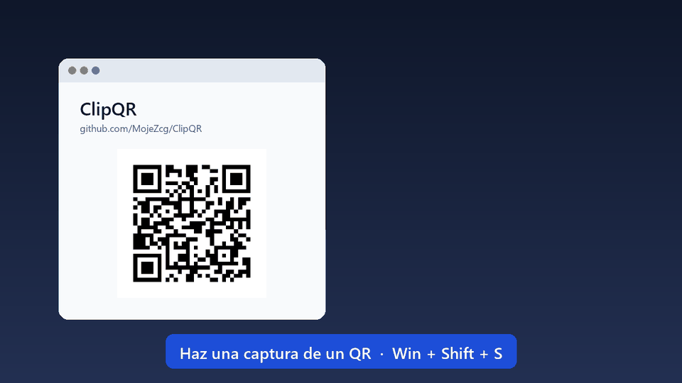

<p align="center"><b>Español</b> · <a href="README.en.md">English</a></p>

<p align="center">
  <picture>
    <source media="(prefers-color-scheme: dark)" srcset="assets/logo-white.png">
    
  </picture>
</p>

<h1 align="center">ClipQR</h1>

<p align="center">
  <b>Haz una captura de un QR y úsalo al instante.</b><br>
  Detecta QR y códigos de barras en lo que copias o capturas en Windows y te deja copiar cada dato,
  conectarte al Wi‑Fi, guardar el contacto o abrir el enlace, con un clic.
</p>

<p align="center">
  
  
  
  <a href="https://cafecito.app/mojezcg"></a>
</p>



## Cómo funciona

1. Haz una captura (`Win`+`Shift`+`S` o `Impr Pant`), copia una imagen o copia un archivo de imagen desde el Explorador. O pulsa **`Win`+`Shift`+`Q`** y rodea el QR con el ratón: se lee al momento, sin capturas ni portapapeles.
2. Si contiene un QR o un código de barras, aparece un aviso arriba a la derecha, en el monitor donde estás.
3. Elige qué hacer: copiar un dato, copiar todo, copiar una parte o usar el botón de acción. Con **`Ctrl`+`Shift`+`Espacio`** lo manejas con el teclado: `Enter` acción, `1`–`9` copiar ese dato, `Esc` cerrar.

**Nada se ejecuta solo.** ClipQR nunca abre enlaces ni se conecta a redes por su cuenta: siempre hay un botón y lo pulsas tú. En los enlaces, avisa si algo no cuadra: conexión sin cifrar, enlace acortado, dominio que imita a otro o que no es el que parece.

## Qué reconoce

| Tipo | Datos que muestra | Botones |
|---|---|---|
| 📶 **Wi‑Fi** | Red, contraseña (oculta), seguridad | **Conectar a la red** |
| 👤 **Contacto** (vCard / MeCard) | Nombre, empresa, teléfono, email, web… | **Guardar contacto**, **Llamar**, **Escribir email**, **Abrir web** |
| 📅 **Evento** | Título, inicio, fin, lugar | **Añadir al calendario** |
| 🔗 **Enlace** | Dominio | **Abrir enlace** |
| ✉️ **Email** | Destinatario, asunto, mensaje | **Escribir email** |
| 📞 **Teléfono / SMS** | Número, mensaje | **Llamar**, **Enviar SMS** |
| 📍 **Ubicación** | Coordenadas | **Ver en el mapa** |
| 🔑 **2FA (otpauth)** | Cuenta, emisor, secreto (oculto) | — |
| 🧾 **Factura** | Importe en grande, tipo, número, fecha, emisor, receptor, código de autorización | **Verificar** en el organismo, **Copiar resumen** |
| 💳 **Pago QR** | Importe, comercio, CVU/CBU, clave Pix o IBAN, referencia, red | **Copiar código de pago** (nunca paga por su cuenta) |
| 🛒 **Producto** (EAN / UPC / GS1) | GTIN, lote, serie, vencimiento, peso | **Buscar producto**, **Ver en GS1** |
| 🪪 **DNI argentino** | Titular, número, nacimiento, ejemplar | **Copiar DNI** (no se guarda en el historial) |
| ✈️ **Tarjeta de embarque** | Vuelo, ruta, fecha, asiento, reserva | **Copiar reserva** (no se guarda en el historial) |
| 💬 **WhatsApp, Telegram, redes, apps** | Número o usuario, mensaje, app | **Abrir chat**, **Abrir en…** |
| 📄 **Texto** | URLs y emails que contenga | **Buscar en Google** |

**Facturas con QR:** Argentina (ARCA, ex AFIP), México (CFDI), Chile (SII), Perú (SUNAT), Colombia (DIAN), Uruguay (DGI), Brasil (NF-e / NFC-e), Ecuador (SRI), España (VeriFactu y TicketBAI) y Portugal (ATCUD). **Pagos:** Transferencias 3.0 (Mercado Pago, MODO, bancos), Pix y demás QR EMVCo, transferencias SEPA, QR-factura suiza, UPI y criptomonedas (solo copiar). Si algo no cuadra (QR alterado, identificador fiscal inválido, producto vencido), lo avisa.

**Crear QR** (`Win`+`Shift`+`G`): Wi‑Fi, contacto, enlace, email, teléfono, SMS, WhatsApp o ubicación, con colores y logo. Se copia o se guarda en PNG o SVG.

También lee DataMatrix, Aztec, PDF417, Code 128, Code 39 y otros formatos, gracias a [zxing-cpp](https://github.com/zxing-cpp/zxing-cpp). Funciona con capturas de pantalla, con fotos borrosas de QR impresos y con imágenes que tienen varios códigos a la vez.

## Capturas

| Wi‑Fi | Contacto |
|---|---|
|  |  |
| **Varios códigos en una imagen** | **Tema claro** |
|  |  |
| **Historial con búsqueda** | **Configuración** |
|  |  |

## Instalación

1. Descarga **`ClipQR-Setup.exe`** desde [Releases](../../releases) y ábrelo.
2. Elige si quieres que se inicie con Windows (y si quieres un acceso directo en el escritorio) y pulsa **Instalar**.

Eso es todo: se instala para tu usuario en `%LOCALAPPDATA%\Programs\ClipQR`, sin permisos de administrador, con acceso directo en el menú Inicio. ClipQR queda en la bandeja del sistema, junto al reloj. Para desinstalarlo: **Configuración de Windows › Aplicaciones › ClipQR**.

La interfaz de ClipQR está en 10 idiomas: español, inglés, portugués, francés, alemán, italiano, chino simplificado, japonés, ruso y coreano. Sigue el idioma de Windows (si no es ninguno de estos, inglés) y se puede cambiar en **Configuración › Idioma · Language**.

¿Prefieres no instalar nada? Descarga **`ClipQR.exe`** (versión portátil) y ábrelo directamente.

> Si aparece Windows SmartScreen («Windows protegió su PC»), pulsa **Más información → Ejecutar de todas formas**. Aparece porque los `.exe` no están firmados digitalmente.

## Configuración

Desde el icono ⚙ del aviso o desde **Configuración…** en el menú de la bandeja:

- **Aviso:** tiempo visible (de 5 s a 5 min), cerrar solo o no, pausa con el ratón encima, animación y posición. El aviso también se puede arrastrar y fijar con 📌.
- **Apariencia:** tema claro, oscuro o el mismo que Windows.
- **Idioma:** español, inglés, portugués, francés, alemán, italiano, chino simplificado, japonés, ruso o coreano. Por defecto, el de Windows (si no está entre estos, inglés).
- **Detección:** solo QR o también códigos de barras, leer archivos copiados desde el Explorador, sonido al detectar y pausar la detección.
- **Borrar la captura al detectar un código** (lo primero de la Configuración, activado por defecto): Windows guarda cada captura en *Imágenes › Capturas de pantalla*. Cuando una contiene un QR o un código de barras, ClipQR la envía a la Papelera (se puede recuperar) y cada aviso lo indica, con un botón **Desactivar**. Solo se borra el archivo idéntico a la captura. Si lo desactivas, el aviso ofrece **Borrar captura**.
- **Historial:** cuántos escaneos se guardan y borrar el historial.
- **Atajos de teclado:** escanear una zona de la pantalla (`Win`+`Shift`+`Q`), crear un QR (`Win`+`Shift`+`G`) y usar el aviso con el teclado (`Ctrl`+`Shift`+`Espacio`). Se pueden cambiar o desactivar. Nunca son `Ctrl`+`Alt`+letra, porque en teclados español y latinoamericano eso es `AltGr` y te impediría escribir @, #, €…
- **General:** iniciar con Windows, buscar actualizaciones (una vez al día; se instalan solo si aceptas y tras comprobar el instalador) e informe de errores para pegar en una incidencia.

Los ajustes se guardan en `%APPDATA%\ClipQR\settings.json`.

## Privacidad

Todo se procesa en tu equipo. ClipQR no envía imágenes ni datos a ningún servidor. Por su cuenta solo consulta una vez al día si hay una versión nueva en GitHub (se puede desactivar). Por lo demás, solo usa la red cuando pulsas un botón que la necesita, como abrir un enlace o buscar un producto. El historial se guarda solo en memoria y se borra al cerrar la aplicación. Todos los detalles, en la [política de privacidad](PRIVACY.md).

## Desde el código

```bash
py -m pip install -r requirements.txt
pythonw main.py                     # ejecutar sin consola
py main.py imagen.png               # decodificar una imagen y mostrar el resultado
py -m pip install -r requirements-dev.txt
py -m pytest                        # tests
build.bat                           # generar dist\ClipQR.exe con PyInstaller
build_setup.bat                     # generar dist\ClipQR-Setup.exe (asistente de instalación)
py tools\make_logo.py               # regenerar assets\logo.png (QR real al repositorio)
py tools\screenshots.py             # regenerar las capturas de docs/screenshots
```

| Archivo | Qué contiene |
|---|---|
| `main.py` | Punto de entrada (el que usa PyInstaller) |
| `clipqr/` | La aplicación: `decode` (lectura), `payloads` (interpretación de cada tipo), `actions`, `settings`, `winplatform` (Windows), `app` (bandeja y portapapeles) y `ui/` (ventanas) |
| `tests/` | Tests automáticos (pytest) |
| `tools/screenshots.py` | Monta escenas con datos de ejemplo y genera las capturas del README |
| `assets/` | Logo (`logo.png`, generado desde `logo-source.jpg`). Su QR lleva a este repositorio |
| `tools/make_logo.py` | Limpia la imagen original y pone en el logo un QR real verificado |
| `installer/setup.py` | Asistente de instalación (instala, accesos directos, inicio con Windows, desinstalador) |
| `build.bat` | Compila el `.exe` en un solo archivo |
| `build_setup.bat` | Compila `ClipQR-Setup.exe` con `ClipQR.exe` dentro |
| `build_msix.ps1`, `msix/` | Paquete MSIX para la Microsoft Store (manifiesto e iconos) |
| `PRIVACY.md`, `PRIVACY.en.md` | Política de privacidad (español e inglés) |
| `docs/store-listing.md` | Textos (español e inglés) y pasos para publicar en la Microsoft Store |

### Paquete para la Microsoft Store

Necesita el [Windows SDK](https://developer.microsoft.com/windows/downloads/windows-sdk/) (incluye `makeappx` y `makepri`).

```powershell
# con los valores de Partner Center › Identidad del producto
.\build_msix.ps1 -IdentityName "<Name>" -Publisher "<Publisher>" -PublisherDisplayName "<PublisherDisplayName>"

# probarlo en este equipo sin certificado (requiere el Modo de desarrollador)
.\build_msix.ps1 -Register
```

Genera `dist\ClipQR-<versión>.msix`. Al instalarse desde la Store, el inicio con Windows usa una *StartupTask* del paquete: viene desactivado y se activa desde la Configuración de ClipQR. Los pasos para publicar están en [docs/store-listing.md](docs/store-listing.md).

## Próximas versiones

- [Hoja de ruta](docs/ROADMAP.md): qué viene hasta la 1.4, PR por PR.
- [Distribución](docs/DISTRIBUCION.md): releases automáticas, firma de código, winget y Microsoft Store.

## Contribuir

¿Quieres añadir un idioma, la factura de tu país o arreglar algo? Lee la [guía para contribuir](CONTRIBUTING.md) y mira las [incidencias para empezar](https://github.com/MojeZcg/ClipQR/labels/good%20first%20issue). Toda ayuda suma, también avisar de un QR que no se lee bien.

## Apoyar el proyecto

ClipQR es gratis y de código abierto. Si te ahorra tiempo, puedes invitarme un cafecito ☕:

<a href="https://cafecito.app/mojezcg"></a>

También está en el menú de la bandeja (**Invitar un cafecito ☕**) y en **Configuración › Apoyar ClipQR**.

## Licencia

[MIT](LICENSE)
